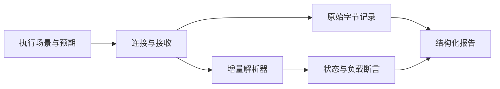

# 从协议分析到自动化执行：让 TCP 测试保留可复核的证据

> 审阅草稿，未自动发布。本文示例是独立编写的教学实验，只使用本机回环 TCP 和模拟报文；不代表工作项目、真实设备或生产环境的验收结果。

网络测试程序收到一段数据后，能否立即判断“设备回复正确”？先要回答三个问题：这一段是不是完整消息、它属于哪次请求、失败时还剩下什么证据。

本文从一个最小场景出发：客户端发送 `PING`，模拟服务端返回 `PONG` 和 `ACK` 两个消息。我们还故意制造半帧后断连，以及连接成功却不响应两种情况。目标不是搭建通用平台，而是把连接、解析、断言和报告的职责分清楚。

## 1. 先说明协议与实验范围

教学协议使用两字节的大端无符号长度，后面紧跟指定长度的负载；负载最多 4096 字节。

例如 `PONG` 的编码是：

```text
00 04 50 4f 4e 47
│     └─ 四个负载字节：P O N G
└─ 两字节长度：4
```

TCP 提供字节流。一条消息可能跨多次读取，也可能与下一条消息一起到达。因此，服务端调用三次 `sendall`，不等于客户端一定调用三次 `recv` 才能收全。

示例同时采用两种验证：对解析器确定性地输入不同切分方式，检查消息边界；通过真实回环套接字，检查关闭连接、超时和接收记录。前者能严格控制切分，后者不能把操作系统这次如何合并字节当作固定规律。

## 2. 将职责拆成五个部分



| 部分 | 负责什么 | 不应该承担什么 |
| --- | --- | --- |
| 连接 | 建立连接、设置超时、发送和接收、关闭资源 | 判断负载是否满足业务要求 |
| 解析 | 保存未完整接收的字节，提取零个或多个消息，限制长度 | 控制重试或直接写报告 |
| 断言 | 比较实际状态、完整消息和预期 | 将超时与断连都归为一个无信息的失败 |
| 证据 | 保存每次接收的十六进制字节、解析产物和剩余缓存 | 用解析文本替换原始字节 |
| 报告 | 汇总已有事实和断言结果 | 为了“成功”而改变断言或隐藏首次失败 |

这是一种教学分工，不表示本站其他项目已经实现了同一套协议执行器。本站仓库中可核查的工程实践包括接口职责划分、自动化测试和发布验证；本文的协议示例位于本草稿的独立 examples 目录。

## 3. 增量解析器怎样处理半帧与合并帧

解析器持有一个字节缓存。每次收到新数据时追加到缓存，然后重复检查：

1. 不足两个字节时，等待完整长度字段。
2. 长度超过限制时立即报错，避免无界等待或内存增长。
3. 消息尚未收齐时保留缓存，等待下一次输入。
4. 消息完整时取出负载，再继续检查缓存中的下一帧。

下面是核心循环；完整代码见 [protocol_evidence_demo.py](examples/protocol_evidence_demo.py)。

```python
while len(self.buffer) >= 2:
    size = int.from_bytes(self.buffer[:2], "big")
    if size > 4096:
        raise ValueError("frame exceeds the teaching protocol limit")
    if len(self.buffer) < size + 2:
        break
    frames.append(bytes(self.buffer[2:size + 2]))
    del self.buffer[:size + 2]
```

连接关闭时，如果缓存还剩不完整数据，应记录“截断”；如果等待超过期限，应记录“超时”。两者对应不同的观察，后续定位方向也不同。

## 4. 运行最小示例

在仓库根目录使用 Python 3.12 或更新版本执行：

```text
python docs/drafts/examples/protocol_evidence_demo.py
```

只使用 Python 标准库，不需要安装第三方包。服务端仅绑定 `127.0.0.1` 的临时端口，不访问外部设备，也不修改数据库。

示例内置的检查包括：

- `PONG + ACK` 共 11 字节，对从 0 到 11 的全部 12 个双片切分位置进行验证。
- 超过 4096 字节的声明长度被拒绝。
- 正常服务端返回两个完整消息。
- 服务端发送不完整消息后关闭，客户端记录截断与剩余字节。
- 服务端保持静默，客户端记录超时。

报告中的 `expectation_met` 表示“实际观察符合该模拟场景的预期”。因此，超时场景可以验证通过，但它不表示被测对象成功响应，也不意味着一个真实产品通过了验收。

## 5. 如何阅读输出

一次接收记录包含 `raw_hex` 和 `decoded_hex`。前者保留原始字节，后者记录这一批输入产生的完整消息；当输入只有半帧时，后者可以为空。

每个场景还记录：

- `status`：完整结束、截断或超时。
- `frames_hex`：所有完整消息的顺序。
- `remaining_hex`：结束时还没组成完整消息的字节。
- `expectation_met`：状态及消息是否与场景预期一致。

接收批次数可能随操作系统调度变化，不能把某一次报告中的批次数写成协议保证。稳定的验证对象是最终消息序列、状态和剩余缓存。

## 6. 本地验证记录与限制

随稿提供 [一次本地运行记录](examples/protocol_evidence_result.json)。该记录只能证明这份模拟示例在记录时运行通过；不证明真实网络、设备、总线或生产系统满足要求。

示例还有明确限制：

- 没有校验和、请求序号、重连、重试和多个会话并发；每个场景只有一个连接。
- 正常场景以服务端关闭连接结束读取。长期保持连接的协议需要另行定义“本次请求完成”的条件。
- 0.5 秒接收超时仅用于实验；正式工具还应区分单次读取超时与整个操作的截止时间。
- 它不是 UDP 实现。UDP 需要考虑数据报长度、丢失、重复、乱序及响应归属，不能直接套用 TCP 的拼帧循环。
- 没有统计吞吐率或真实业务效率，也没有形成任何硬件验收结论。

下一步可以先补请求标识和总截止时间，再设计重试时保留各次尝试的证据。只有这些语义稳定之后，统一报告或扩展适配器才有明确基础。
